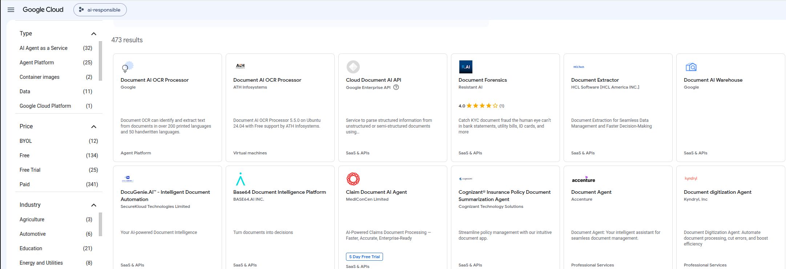
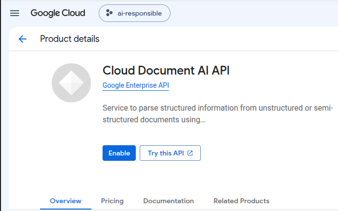
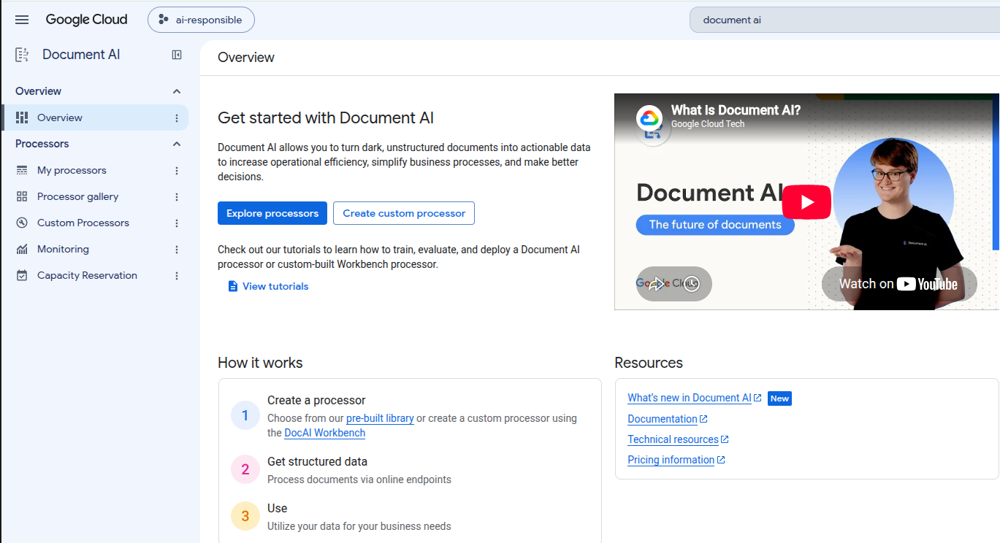
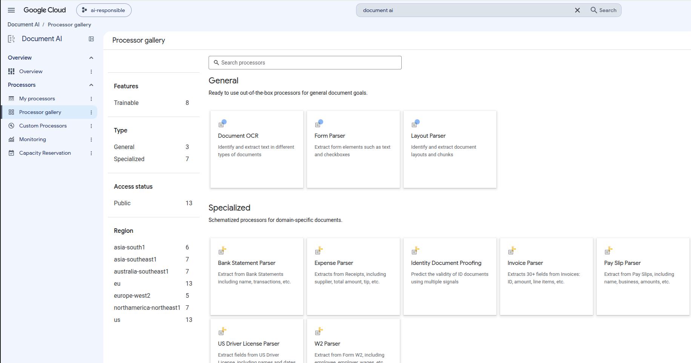
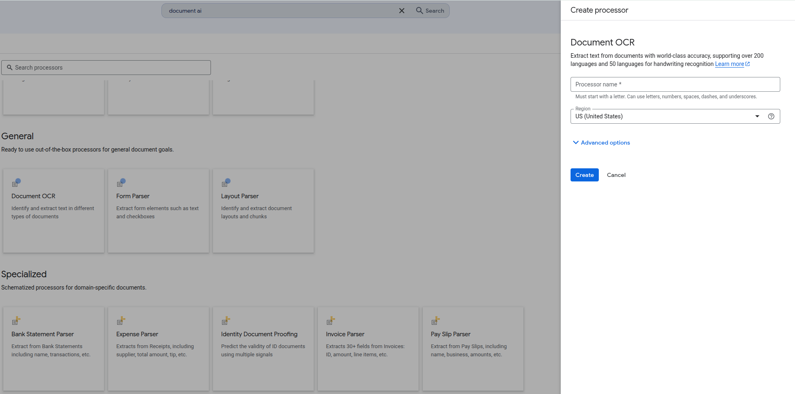
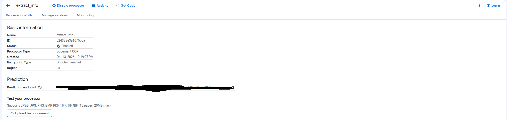
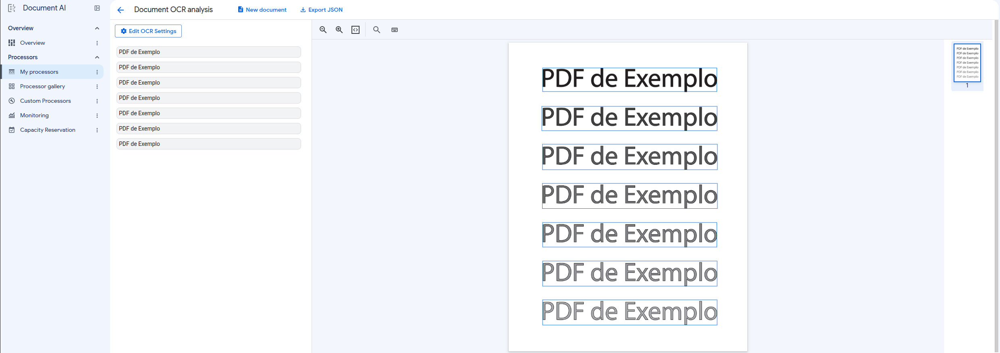
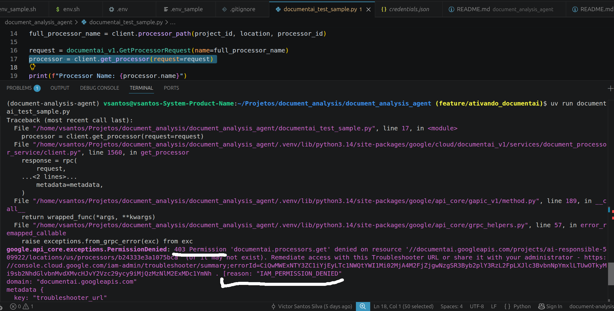

# Ativando, Configurando e Usando o DocumentAI
DocumentAI é um conjunto de ferramentas integradas de IA generativa e aprendizado de máquina para analisar, extrair, classificar e dividir documentos estruturados e/ou não estruturados.

## Como ativar o serviço
- No MarketPlace da GCP, procure por document-ai, e selecione o item __Cloud Document-AI API__

- Ao acessar o produto, você deve agora habilitar o uso da API. Para este passo, é necessário que o seu projeto tenha uma billing account configurada. Pode ser com a conta gratuíta (3 meses para gastar os créditos). Portanto, clique em __Enable__
 

- __Acessando DocumentAI__: Na página do [console](https://console.cloud.google.com/), procure pelo produto Document AI

- __Processor Gallery__: Na coluna à esquerda, acesse Processor gallery. Então será aberto uma página com todos os Processadores que o DocumentAI já oferece prontos. 
Nessa página, também há a opção de usar o __Document OCR__ (sigla para Optical Character Recognition ou Reconhecimento Óptico de Caracteres), que vai cumprir bem a função que desejamos. Então, devemos escolhê-lo:

## Criar o Processador
- Ao clicar em __Document OCR__, um menu vertical na direita irá abrir, onde você deve informar o nome do seu Processador que será criado. 

- Ao final de alguns segundos, após clicar em create, se tudo ocorrer bem, uma página como a seguir será exibida: 

- Antes de finalizarmos a parte da construção do nosso processador, vamos testá-lo. Na página em que está aberto, no canto inferior esquerdo há um botão "Upload test Document", clique nele para testar o processador. 

- Para este teste, utilizei o seguinte pdf [PDF TESTE](images/pdf_sample_2.pdf). Verificamos que o processador foi capaz de coletar corretamente cada bloco de texto. Embora isto seja muito simples, fique a vontade para usar outros arquivos e/ou outros formatos, para melhor estressar o processador.

## Dando Permissão para a Service Account
- Nesta etapa do processo, a execução do módulo python `documentai_test_sample.py`, retornará um erro de permissão __(403)__, cuja razão é __IAM_PERMISSION_DENIED__.

- Assim como, para utilizar a IA através do Vertex precisamos dar essa permissão a nossa Service Account, vamos atribuir a ela uma role apropriada.
